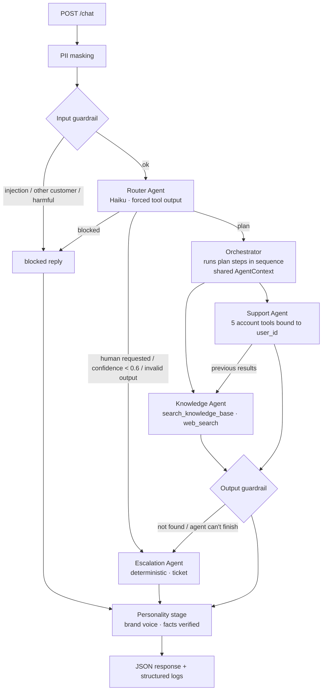

# Getnet Multi-Agent Support System

A multi-agent service that answers Getnet merchants: product questions grounded in Getnet's website (RAG), general questions via web search, and account-specific support using the merchant's own data. A Router decides which agent (or sequence of agents) handles each message; guardrails and a human-escalation agent cover what the system should not or cannot answer.

Built with **Spec-Driven Development**: [`docs/spec.md`](docs/spec.md) (what/why) → [`docs/plan.md`](docs/plan.md) (how) → [`docs/tasks.md`](docs/tasks.md) (verifiable steps). The acceptance criteria in the spec are the golden set used by the tests and the eval runner.

**Stack:** Node 22 · TypeScript (strict) · Fastify · zod · Anthropic SDK (Claude + server-side web search) · transformers.js (local multilingual embeddings) · cheerio · pino · Vitest · Docker.

Only one secret is needed: `ANTHROPIC_API_KEY` — or none at all with the **local profile**, which runs a free open model (Ollama + qwen2.5:7b) inside Docker.

---

## Quick start

```bash
cp .env.example .env              # add your ANTHROPIC_API_KEY
npm install
npm run ingest                    # crawl Getnet pages → data/index.json (≈1–2 min, first run downloads the embedding model)
npm run dev                       # http://localhost:3000

curl -s localhost:3000/chat -H 'content-type: application/json' \
  -d '{"message":"Can I sell through WhatsApp using the Payment Link?","user_id":"cliente1988"}' | jq
```

### With Docker

```bash
cp .env.example .env              # add your ANTHROPIC_API_KEY
npm install && npm run ingest     # build data/index.json on the host (or skip if it's already committed)
docker compose up --build         # the embedding model is cached in the image at build time
```

### Without any API key (local LLM)

```bash
docker compose --profile local up --build
```

This starts three containers: `ollama` (model server), `ollama-pull` (downloads `qwen2.5:7b`, ~4.7 GB, once — cached in a volume) and `api-local` (this service with `LLM_PROVIDER=ollama`). Needs ~8 GB of free RAM; on CPU each request takes 20–60 s, and routing/tool-calling quality is below Claude's. Pick another model with `OLLAMA_MODEL=llama3.1:8b` (or `qwen2.5:3b` for small machines). The Anthropic server-side web search is replaced by a local DuckDuckGo tool, so the weather/exchange-rate scenarios still work. Same code, same tests: the provider is just another adapter behind `LLMClient`.

To refresh the index from inside the container instead: `docker compose run --rm --user root api npm run ingest:prod` (writes to the mounted `./data`; on Linux the file ends up owned by root).

Commit `data/index.json` after ingesting: it is a snapshot, so the API (and the container) starts without network access to Getnet. Re-run ingestion to refresh it. Without an index the API still starts and logs a warning; Getnet questions then end in an honest "not found" + handoff.

### Tests and evaluation

```bash
npm test          # unit + integration (no network, no API key: the LLM is a scripted fake)
npm run typecheck
npm run eval      # golden set against the REAL model → scorecard + eval-report.json (needs the key and an index)
EVAL_BASE_URL=http://localhost:3000 npm run eval   # same, against a running server/container
```

### Configuration

| Variable | Default | Purpose |
|---|---|---|
| `LLM_PROVIDER` | `anthropic` | `anthropic` (Claude API) or `ollama` (free local model) |
| `ANTHROPIC_API_KEY` | — | Required for `anthropic` |
| `OLLAMA_URL` / `OLLAMA_MODEL` | `http://localhost:11434` / `qwen2.5:7b` | For `ollama` (all roles use this one model) |
| `ROUTER_MODEL` | `claude-haiku-5-5` | Cheap, fast classification |
| `AGENT_MODEL` | `claude-sonnet-5-5` | Knowledge and Support agents |
| `PERSONALITY_ENABLED` / `PERSONALITY_MODEL` | `true` / `claude-haiku-5-5` | Brand-voice stage on every answer |
| `ROUTER_CONFIDENCE_THRESHOLD` | `0.6` | Below this, the request goes to a human |
| `AGENT_MAX_ITERATIONS` | `5` | Tool-loop budget per agent |
| `WEB_SEARCH_MAX_USES` | `2` | Cap on web searches per request (cost control) |
| `EMBEDDER` | `e5` | `e5` = local `multilingual-e5-small`; `hashing` = offline lexical fallback |
| `RETRIEVAL_TOP_K` / `RETRIEVAL_MIN_SCORE` | `6` / per-embedder | Retrieval tuning |
| `PORT`, `LOG_LEVEL` | `3000`, `info` | |

---

## API

`POST /chat`

```json
{ "message": "When will the money from yesterday's sales be deposited?", "user_id": "cliente1988" }
```

```json
{
  "trace_id": "3f0c…",
  "answer": "Your card sales from Thursday, 2026-10-22 (BRL 481.40 gross) …",
  "route": "support",
  "agents": ["router", "support", "personality"],
  "sources": [],
  "tools_used": ["get_settlements"],
  "handoff": { "required": false, "reason": null, "ticket_id": null },
  "latency_ms": 4210
}
```

- `route`: `knowledge | support | escalation | blocked`
- `agents`: agents that actually ran, in order (the plan)
- `sources`: pages used to ground the answer (Getnet pages, internal docs or web results)
- `handoff`: whether a human should take over, why, and the ticket id when one was opened
- `400` for invalid payloads (with field errors), `500` only for unexpected bugs (with `trace_id`). `GET /health` → `{ status, knowledge_base_chunks }`.

Mock customers: `cliente1988` (Get Smart, machine offline, declined transactions, D+1 settlement) and `cliente2000`. Any other `user_id` exercises the "account not found" path.

---

## Architecture



### Agents

| Agent | What it does | How it uses the LLM |
|---|---|---|
| **Router** | Entry point. Classifies the message into a route, an execution **plan** (`["knowledge"]`, `["support"]` or `["support","knowledge"]`), a confidence and the language. | Claude Haiku with **forced tool use** (`route_decision`), whose input schema is generated from the same zod schema that validates the output. Invalid output → escalation (FR1). |
| **Knowledge** | Getnet products/services (RAG) and general, time-sensitive questions (web). | Claude Sonnet in a tool loop with `search_knowledge_base` (our RAG, exposed as a tool so the model can reformulate the query in Portuguese and search again) and Anthropic's **server-side `web_search`** (capped). Must answer only from excerpts, or say it didn't find it (`<<NOT_FOUND>>`). |
| **Customer Support** | The merchant's own account: settlements, transactions/declines, card-machine diagnostics, tickets. | Claude Sonnet in a tool loop with `get_customer_profile`, `get_settlements`, `get_transactions`, `get_terminal_status`, `create_support_ticket`. Tools are **bound to the authenticated `user_id` by the orchestrator** — the model never chooses whose data it reads (FR6). Unknown users are answered deterministically, without an LLM call. |
| **Escalation** (bonus) | Human handoff: opens a ticket and tells the merchant what happens next. | No LLM, on purpose: handoff must work even when the LLM is down, and it must be predictable. |
| **Personality** (diagram stage) | Gives every answer one brand voice before output, whichever agent (or fixed template) wrote it. | Claude Haiku rewrites tone only. Code extracts every amount, date, code and ticket id from the draft and keeps the original if any is missing from the rewrite, so the stage can never make an answer less accurate. `PERSONALITY_ENABLED=false` turns it off. |

**Communication mechanism:** direct async function calls through the `Orchestrator`. Every agent implements `run(ctx: AgentContext) → AgentResult`; the context carries `traceId`, `userId`, the masked message, the language, the results of earlier plan steps (`previous`) and the steps still to come (`nextSteps`). With 3–4 agents and linear plans this is the simplest design that is easy to test and to explain; the `Agent` interface would let the steps move to a queue later without touching the agents.

### Message workflow (scenario #5, multi-step)

1. *"My card machine won't connect to the internet, what should I do?"* → PII masking and input guardrail pass.
2. Router → `{ route: "support", plan: ["support","knowledge"], confidence: 0.85, language: "en" }`.
3. Support runs with `nextSteps=["knowledge"]`, so its prompt tells it to report only what the data shows. It calls `get_terminal_status` → "Get Smart GS-1988-0001 offline for 3h, NETWORK_UNREACHABLE".
4. Knowledge runs with `previous=[support result]`; the findings are passed inside `<account_findings>`. It searches the KB (playbook + Getnet pages) and writes **one** final answer that starts from the account data and adds the steps.
5. Output guardrail checks grounding; the Personality stage rewrites the tone (facts verified); response includes `agents: ["router","support","knowledge","personality"]`, both tools and the sources.

### Design patterns

**Architectural style — Hexagonal (Ports & Adapters).** The core (orchestrator + agents) depends only on ports: `LLMClient`, `CustomerRepository`, `VectorStore`, `Embedder`. Anthropic, the JSON mock, transformers.js and Fastify are adapters at the edges, wired in a single composition root.

| Pattern | Where | Why |
|---|---|---|
| **Mediator** | `orchestrator.ts` | Agents never call each other; the orchestrator passes results forward through `AgentContext`. Low coupling between agents. |
| **Strategy** | `Agent` (knowledge/support), `Embedder` (e5/hashing), `LLMClient` | Behaviour picked at runtime: by the Router's plan or by configuration. |
| **Adapter** | `llm/anthropic.ts`, `llm/ollama.ts` | Each provider is one adapter behind `LLMClient`; `capabilities` tells agents what the provider lacks (e.g. no server-side search → local DuckDuckGo tool). |
| **Repository** | `support/repository.ts`, `mockRepository.ts` | Data access isolated from tools; the mock becomes a real Getnet API by adding an implementation. |
| **Factory** | `defineTool`, `createSupportTools`, `createKnowledgeBaseTool`, `createEmbedder` | `defineTool` builds a tool from one zod schema that produces the model-facing JSON Schema *and* validates the model's input. |
| **Decorator** | `agents/support.ts` wraps `create_support_ticket` | Captures the ticket id without changing the tool. |
| **Dependency Injection / Composition Root** | `container.ts` | The only place that knows concrete classes; tests inject the fake LLM and a fixed clock. |
| **Test Double (Fake)** | `llm/fake.ts` | Whole pipeline tested offline, deterministically, for free. |

**Agentic patterns** (vocabulary from Anthropic's *Building Effective Agents*): **Routing** (Router → specialist), **Plan-and-Execute / prompt chaining** (`support → knowledge` with output passed forward), **Orchestrator–Workers**, **Tool-use loop** with an iteration budget (`toolLoop.ts`), **Agentic RAG** (retrieval exposed as a tool), **Structured output via forced tool call**, **Layered guardrails**, **Human-in-the-loop** escalation, and **Fallback / graceful degradation** (invalid router output → escalation; no web search → RAG only).

---

## RAG pipeline

**1. Ingestion** — `src/rag/ingest.ts`, `src/rag/crawler.ts`, seeds in [`data/sources.json`](data/sources.json)
- Seeds: the two URLs from the challenge (`getnet.net`, `getnet.net/en`), the Brazilian Getnet site (`site.getnet.com.br`: machines, Pix, payment link, crediário, digital account, help center) and Santander's Getnet pages. `getnet.net` is the global corporate site; the Brazilian product content (Get Clássica, Get Smart, Pix, crediário…) lives on `site.getnet.com.br`, which is why it was added.
- Breadth-first crawl, same host only, depth ≤ 2, ≤ 60 pages, URL keyword filter, robots.txt `Disallow` honoured, 300 ms between requests.
- Cleaning with cheerio: drops nav/header/footer/scripts/forms, keeps headings as `## ` markers and deduplicates repeated blocks (menus repeated across the page).
- Internal docs: Markdown files in `data/knowledge/` are ingested too. `support-playbook.md` is a **synthetic, clearly labelled** first-level support guide (connectivity steps, decline codes) — the public site has no troubleshooting content, and the challenge mentions internal sources.

**2. Chunking & embedding**
- Heading-aware chunker (`chunker.ts`): sections by heading, ~1,800 chars (~450 tokens) with 300-char overlap; the heading is prepended so each chunk stands alone.
- Embeddings: `Xenova/multilingual-e5-small` (ONNX, local via transformers.js) with the `passage:` / `query:` prefixes e5 expects. Multilingual on purpose: the pages are in Portuguese and the questions in English.

**3. Storage** — `vectorStore.ts`: in-memory cosine search behind a `VectorStore` interface, persisted as `data/index.json` (chunks, vectors, metadata, embedder id). A few hundred chunks don't justify a database; swapping to pgvector/LanceDB means implementing one interface. Loading an index built with a different embedder fails fast.

**4. Retrieval** — `retriever.ts`: top-k = 6, model-specific similarity threshold, at most 2 chunks per URL (diversity).

**5. Generation** — the Knowledge agent calls `search_knowledge_base` as a tool. Excerpts come back numbered with title and URL; the prompt requires answering only from them, treating them as data (prompt-injection defence) and declaring `<<NOT_FOUND>>` otherwise. Sources are attached to the response by the system, not typed by the model.

---

## Guardrails and human handoff

| Layer | What | Where |
|---|---|---|
| PII | Card numbers (Luhn-checked), CPF, CNPJ and e-mails are masked **before** logs and before the LLM | `guardrails/pii.ts` |
| Input | Prompt injection, references to another customer's id, clearly harmful requests (card cloning, laundering) → `blocked`, **no LLM call** | `guardrails/input.ts` |
| Router | Second line: can return `blocked` (subtle cases) or `escalation` | `agents/router.ts` |
| Data isolation | Support tools are created per request with the authenticated `user_id` | `support/tools.ts` |
| Output | Knowledge answer with `<<NOT_FOUND>>` → handoff with ticket; answer without any source → disclaimer + `handoff.required` | `guardrails/output.ts` |
| Reliability | Router failure, low confidence, agent exception or iteration limit → Escalation agent (HTTP 200 with a ticket, not a 500). Web search not enabled for the org → Knowledge retries without it, so RAG keeps working | `orchestrator.ts`, `agents/knowledge.ts` |
| Cost | Web searches capped per agent run (not per API call), cheap router model | `agents/toolLoop.ts` |
| Unknown account | Deterministic "account not found" + handoff **offer** (no ticket for a non-existent account) | `agents/support.ts` |

---

## Observability

Every request has a `trace_id` (also the Fastify request id) and produces one JSON log line per stage (`request`, `guardrail_input`, `router`, `agent`, `guardrail_output`, `response`) with latency, token usage, web searches, route, plan, confidence, tools and handoff reason:

```json
{"level":30,"trace_id":"4a03…","user_id":"cliente1988","stage":"router","agent":"router","latency_ms":412,"route":"support","plan":["support","knowledge"],"confidence":0.85,"tokens":{"inputTokens":1204,"outputTokens":61,"webSearches":0}}
```

**In production** these logs go to an OpenTelemetry collector / log pipeline, and the same fields drive:
- **Dashboards:** requests by route, plan distribution, escalation rate by reason, blocked rate by category, p50/p95 latency per agent, tokens and web searches per request (cost), knowledge "not found" rate (content gaps).
- **Alerts:** error/`agent_error` rate, escalation spike, p95 latency above the SLO, router fallback rate, cost per request.
- **Quality loop:** escalated and `not_found` conversations are reviewed and added to `tests/eval/scenarios.json`; the eval runs on every prompt/model change with a route-accuracy gate (`EVAL_MIN_ROUTE_ACCURACY`, exits 1 below it). Prompts are versioned (`PROMPT_VERSION`).
- Next steps: LLM-as-judge for groundedness/faithfulness on sampled traffic, tracing with Langfuse/LangSmith spans per tool call, user feedback (thumbs) in the response contract.

---

## Testing strategy

| Level | Scope | How |
|---|---|---|
| **Unit** (`tests/unit`) | Tool loop, chunker, HTML extraction, retrieval ranking, index persistence and embedder mismatch, repository date logic (business days, relative dates), each support tool, cross-customer isolation, PII masking, guardrail patterns (true and false positives), plan normalisation | Vitest, no network |
| **Integration** (`tests/integration`) | The full HTTP pipeline through Fastify `inject`, with a **scripted fake LLM per agent**: every spec scenario route (#1 RAG, #2 web, #3 settlements, #5 multi-step, #8 declines), tickets, N1–N4 negatives, router malformed output, low confidence, knowledge gap, ungrounded answer, LLM outage, PII never reaching the LLM, `/health` | The fake records every request, so tests assert on **what each agent sent to the model** (tool results, prompts, context passed between agents), not only on the final JSON |
| **Evaluation** (`tests/eval`) | Golden set from the spec with the real model: route, plan, tool, sources, content and handoff checks; p50/p95 latency | `npm run eval`, scorecard + `eval-report.json`, CI gate on route accuracy |

How to make integration testing comprehensive for the orchestration: test the **contracts between agents** (what the Router emits, what the orchestrator passes in `previous`/`nextSteps`, what each agent returns) with deterministic fakes; cover every edge of the workflow graph (each route, each escalation reason, each guardrail) as its own test; keep the real-model checks in the eval suite, which is non-deterministic and costs money, and run it on prompt/model changes and nightly rather than on every commit.

---

## Design decisions and trade-offs

- **Own orchestrator instead of LangGraph/LangChain:** 4 agents and linear plans don't need a graph framework; plain TypeScript is easier to test, debug and explain. The cost is re-implementing a small tool loop (`agents/toolLoop.ts`, ~60 lines).
- **Router as forced tool call + zod:** structured output with schema validation, and a single schema source for the JSON Schema and the validator.
- **Cheap router, stronger answering model:** most of the cost sits where quality matters.
- **RAG as a tool, not pre-stuffed context:** the model decides the query (and translates it), can search twice, and skips retrieval for general questions.
- **Local embeddings:** no second API key; multilingual e5 bridges EN questions and PT pages. Trade-off: a ~120 MB model download at build time.
- **Deterministic escalation and unknown-user paths:** the most sensitive paths don't depend on the LLM.
- **Stateless requests:** no conversation memory (non-goal in the spec); adding it means storing turns per `user_id` and passing them in `AgentContext`.

## Limitations

- Customer data is synthetic (`data/customers.json`), behind the `CustomerRepository` interface; settlement rules ignore bank holidays.
- The crawler reads server-rendered HTML only; JS-rendered pages are reported as "too little text".
- Sources list every retrieved page, not only the ones the model cited.
- Tickets are in memory.

## Project structure

```
src/
  main.ts  server.ts  container.ts  orchestrator.ts  config.ts  types.ts
  agents/       router.ts knowledge.ts support.ts escalation.ts personality.ts toolLoop.ts defineTool.ts webSearchTool.ts prompts.ts
  llm/          client.ts (interface) anthropic.ts ollama.ts fake.ts
  rag/          ingest.ts crawler.ts chunker.ts embedder.ts vectorStore.ts retriever.ts
  support/      repository.ts (interface) mockRepository.ts tools.ts dates.ts
  guardrails/   input.ts output.ts pii.ts language.ts
  observability/logger.ts
data/           sources.json customers.json knowledge/ index.json
tests/          unit/ integration/ eval/ helpers.ts
docs/           spec.md plan.md tasks.md
```
