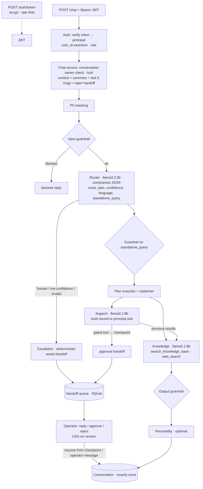

# Getnet Multi-Agent Support System — v2

A multi-agent API for Getnet merchants: a **Router** sends each message to a **Knowledge** agent (RAG over Getnet's site + web search) and/or a **Customer Support** agent (tools over the merchant's own data), with guardrails, persistent conversations, real authentication, an operational **human-in-the-loop** queue and a semantic evaluation that runs against the deployed API. It runs fully local and free by default (Ollama), on any machine, with one command.

## How this was built

1. **v1** (tag [`v1-submission`](https://github.com/EduardoColissi/agents-orchestration/tree/v1-submission)) was the original submission. It received a detailed review: strong orchestration, RAG and guardrails; weak memory (1.0/10), authentication, human-in-the-loop (4.0/10) and evaluation.
2. **v2** was rebuilt from v1 to close those gaps, with Spec-Driven Development: [`docs/spec.md`](docs/spec.md) → [`docs/plan.md`](docs/plan.md) → [`docs/tasks.md`](docs/tasks.md), written and committed before the clock. **The core was built in 39 min 41 s** (tags `v2-clock-start` → `v2-clock-end`; the first commit of the clock imports v1 and says so).
3. **After the clock**, three verification passes produced further `fix:` commits, each declared as post-clock in [`docs/timesheet.md`](docs/timesheet.md): an independent review of the whole diff, a re-evaluation of the result against the brief and the review (same rubric), and a hands-on walk through the test plan — starting with the review's own example, "Minha maquininha está offline.", which still answered badly ([why, and what changed](#design-decisions-and-trade-offs)). One more declared change followed on 2026-10-30: a search API behind the local web search, and two prompt rules found by evaluating it ([results](#results)).
4. This branch merges v2 into v1: both histories are preserved, the content is v2's. The companion [UI](https://github.com/EduardoColissi/agents-orchestration-UI) (merchant chat + operator console) was updated to the v2 API.

The result keeps what was rated strong and closes the loops that were left open. [`docs/checklist.md`](docs/checklist.md) maps every point of the brief and of the review to where it lives and how it is proved. Video walkthrough: to be added.

## The review questions, answered

The review ended with six questions. Each has an answer in this codebase; the full version, with every test and evidence file, is in [`docs/checklist.md`](docs/checklist.md#the-review-questions).

1. **Where does authentication happen, and how does `user_id` stop being controlled by the payload?** In [`POST /auth/token`](src/auth/): the credential (scrypt) becomes an HS256 JWT with the merchant as `sub` and a role. Every other route requires the Bearer token; `/chat` takes the merchant from the token, a different `user_id` in the body is refused with 403 `user_mismatch` before any model call, and the Support tools are created with that id bound by closure, so the model only chooses the operation. Tests: `tests/integration/auth.test.ts`, `chat.test.ts`; eval cases N4, N5, `no_cross_merchant_data`.
2. **How does the conversation survive between requests and after a restart?** `/chat` returns a `conversation_id`; conversations, messages, handoffs and the audit log live in SQLite on the `app-state` Docker volume, owned by the merchant (404 for anyone else). Each turn gives the Router and the agents a rolling summary plus the last six messages and rewrites follow-ups into a standalone question. The JWT key is persisted next to the database, so a token issued before `docker compose restart api` is still valid after it: [`docs/evidence/restart.log`](docs/evidence/restart.log). Tests: `memory.test.ts`, `context.test.ts`; eval MT1, MT2.
3. **How does an operator receive a ticket, reply and return control to the agent?** The agent interrupts the run (a request for a person, or the approval-gated `request_terminal_replacement`) and a handoff is written with the checkpoint and the evidence. An operator, with their own login, lists the queue (`GET /operator/handoffs`) and resolves it (`POST /operator/handoffs/:id/resolve` with `approve`, `reject` or `reply` and `expected_version`; a second resolve gets 409). Approve and reject resume the saved run from the checkpoint and the outcome reaches the conversation exactly once; a reply is delivered to the merchant and the agent sees it on the next turn (a declared limit). Pending handoffs expire, interrupted resolutions are finished at boot, everything is audited, and the [UI](https://github.com/EduardoColissi/agents-orchestration-UI) has the operator console. Tests: `hitl.test.ts`; eval H1–H3; UI smoke (26 checks).
4. **How is the final answer proved factually correct and grounded?** [`npm run eval`](#evaluation) runs the golden set against the deployed API three times, and an independent judge of another model family (qwen locally, Claude as the reference) scores groundedness against the recorded evidence, correctness against reference facts, relevance, helpfulness and safety. Canaries with known defects detect an unreliable judge, a baseline with a regression gate blocks regressions, and every report records the build. Where the answers are not correct (RAG on the 8B), the [results](#results) say so.
5. **What makes the system replan after observing a specialist's result?** [`src/orchestration/replanner.ts`](src/orchestration/replanner.ts) decides after each specialist: an offline machine in `get_terminal_status` adds Knowledge (which also receives the troubleshooting guide, searched in code), a crashed Support tool escalates to a person, unavailable live data finishes without one; the orchestrator then joins Support's facts and Knowledge's guidance in code. Tests: `replan.test.ts`; eval R1 (`replanned` 1.0).
6. **Which artifacts prove that Docker, the live evaluation and the critical flows were executed?** [`eval/reports/`](eval/reports) (every report with the API build and the runner commit) and [`eval/baseline.json`](eval/baseline.json); [`docs/evidence/`](docs/evidence) (restart log, metrics, GPU); [`.github/workflows/ci.yml`](.github/workflows/ci.yml) (typecheck, tests, compose validation, image build, container smoke with a restart); the UI's `scripts/smoke.mjs`; [`docs/timesheet.md`](docs/timesheet.md) with the commit timeline.

## What changed from v1

| Review gap | v2 | Where | Proof |
|---|---|---|---|
| **Memory** (1.0/10): every request was stateless | `conversation_id`; turns persisted in SQLite (survive restarts); the Router **and** the agents receive a rolling summary + the last 6 messages; follow-ups rewritten into `standalone_query`, which Knowledge searches with; deterministic compaction that keeps ids/amounts/dates verbatim; per-owner isolation | `src/chat/service.ts`, `src/memory/*`, `src/store/conversations.ts` | `tests/integration/memory.test.ts`, `context.test.ts`; eval cases MT1/MT2 |
| **Authentication**: `user_id` in the body *was* the identity | JWT (HS256 pinned, `iss`/`aud`/`exp`) → principal → role check → tools bound to `sub`. `user_id` in the body is only an assertion: a mismatch is 403 before any LLM call. Another merchant's conversation is 404. Login rate limited, scrypt, audited | `src/auth/*`, `src/server.ts` | `tests/integration/auth.test.ts`; eval N4/N5 |
| **Human-in-the-loop** (4.0/10): "handoff" opened a ticket and stopped | Agent interrupt → persistent queue → identified operator replies / approves / rejects → the agent resumes and finishes. Approval stops the tool loop **before** a sensitive action, checkpoints it and resumes from it. Compare-and-set on `version`, idempotent side effect, exactly-once delivery, TTL expiry, crash recovery at boot, append-only audit | `src/hitl/service.ts`, `src/store/handoffs.ts`, `src/agents/toolLoop.ts`, `src/agents/support.ts` | `tests/integration/hitl.test.ts`; eval H1/H2/H3 |
| **Evaluation**: lexical checks; the one real run was gitignored | HTTP-only evaluation of the **deployed** API with a judge from another model family, reference facts fixed before the build, N runs with spread, calibration canaries, baseline gate, versioned reports. v1's real run is now versioned too | `eval/*` | `eval/reports/*`, `eval/baseline.json`, `eval/history/` |
| **Replanning** | After each specialist, a deterministic policy reads tool signals and decides: add a step (offline machine without troubleshooting planned → Knowledge), hand over to a person (a support tool crashed), or finish without a person (live web data unavailable) | `src/orchestration/replanner.ts` | `tests/integration/replan.test.ts`; eval R1 |
| **Production evidence** | `/ready` (DB, KB, LLM + models), GitHub Actions (typecheck, tests, compose validation, image build, container smoke with restart), Docker volume for state | `.github/workflows/ci.yml`, `src/container.ts` | CI; [`docs/evidence/restart.log`](docs/evidence/restart.log) (conversation, open handoff and token survive `docker compose restart`; the operator resolves after it), [`gpu.log`](docs/evidence/gpu.log), [`metrics.json`](docs/evidence/metrics.json) |
| **AI observability** | Spans persisted per stage (router, agent, tool, RAG, personality) with duration, tokens and status; `GET /operator/metrics` → p50/p95/p99 per stage and per turn, tokens, error/escalation/blocked rates | `src/store/spans.ts` | `tests/integration/observability.test.ts` |

Kept from v1 (rated strong): own orchestrator (no framework), multi-step plan with results passed forward, zod tools with the merchant bound by closure, bounded tool loop, deterministic input guardrail + PII masking + grounding check, the RAG pipeline (crawler with robots.txt, heading chunks, local multilingual e5, persisted index, URL diversity, RAG as a tool), deterministic escalation and — now on the local provider too — a **cheap router + stronger specialists** (`llama3.2:3b` routes, `llama3.1:8b` answers; Claude Haiku/Sonnet with `LLM_PROVIDER=anthropic`). The first commit of the clock imports v1 and says so.

## Quick start

### Docker (any machine)

```bash
docker compose up --build                                                   # CPU: works everywhere, slower
docker compose -f docker-compose.yml -f docker-compose.gpu.yml up --build   # NVIDIA GPU (WSL2 / Linux)
```

No `.env` and no API key needed. The first `up` downloads `llama3.2:3b` and `llama3.1:8b` (~7 GB, cached in a volume); the API listens on `http://localhost:3000` (loopback only, because the demo credentials below are public; `API_BIND=0.0.0.0` exposes it). On a GPU machine you can put `COMPOSE_FILE=docker-compose.yml;docker-compose.gpu.yml` in `.env` (`:` instead of `;` on Linux/macOS). Already running Ollama on the host (e.g. macOS with Metal)? `COMPOSE_OLLAMA_URL=http://host.docker.internal:11434 docker compose up --build --no-deps api`. Claude instead of local models: `LLM_PROVIDER=anthropic` and `ANTHROPIC_API_KEY` in `.env`.

```bash
docker compose ps                       # api: healthy
curl -s localhost:3000/ready            # {"status":"ready","checks":{"database":…,"knowledge_base":…,"llm":…}}
```

The first chat turn after a start loads the models into memory (~30 s on a GPU, more on CPU); later turns take a few seconds. To start over without conversations, queue items or tickets, remove the state volume (`docker compose down && docker volume rm agents-orchestration_app-state`, prefixed with your checkout's folder name); `docker compose down -v` also deletes the downloaded models.

### Configuration

Everything is optional and listed in [`.env.example`](.env.example) (read from `.env`, by the API and by the evaluation). The ones you are most likely to change:

| Variable | Default | Purpose |
|---|---|---|
| `LLM_PROVIDER` | `ollama` | `ollama` (local, free) or `anthropic` |
| `OLLAMA_ROUTER_MODEL` · `OLLAMA_AGENT_MODEL` | `llama3.2:3b` · `llama3.1:8b` | local router and specialists |
| `ANTHROPIC_API_KEY` · `ROUTER_MODEL` · `AGENT_MODEL` | — · `claude-haiku-5-5` · `claude-sonnet-5-5` | Claude provider |
| `AUTH_JWT_SECRET` · `AUTH_TOKEN_TTL_S` | generated once in the data volume · `3600` | token signing key and lifetime |
| `HANDOFF_TTL_MINUTES` · `CHAT_RATE_LIMIT_PER_MIN` | `240` · `20` | approval expiry · chat turns per merchant per minute |
| `PERSONALITY_ENABLED` · `EMBEDDER` | `false` · `e5` | brand-voice stage · `hashing` = offline embeddings |
| `BRAVE_SEARCH_API_KEY` | — | web search on the local provider (Brave Search API, free plan); unset = DuckDuckGo HTML, which some networks block |
| `JUDGE_PROVIDER` · `JUDGE_MODEL` | `ollama` · `qwen2.5:7b` | evaluation judge (`anthropic` → `claude-sonnet-5-5`) |
| `COMPOSE_FILE` · `API_BIND` · `COMPOSE_OLLAMA_URL` | — · `127.0.0.1` · `http://ollama:11434` | Docker Compose only |

### Try it

Demo identity provider (in production this is the company's OIDC provider):

| User | Password | Role |
|---|---|---|
| `cliente1988` | `demo-cliente1988` | merchant (Padaria Pão Dourado, Get Smart offline) |
| `cliente2000` | `demo-cliente2000` | merchant |
| `ghost42` | `demo-ghost42` | merchant without a Getnet account |
| `op.ana`, `op.bruno` | `demo-op.ana`, `demo-op.bruno` | operators |

```bash
login() { curl -s localhost:3000/auth/token -H 'content-type: application/json' -d "{\"username\":\"$1\",\"password\":\"demo-$1\"}" | jq -r .access_token; }
M=$(login cliente1988); O=$(login op.ana)

# Turn 1 starts a conversation…
C=$(curl -s localhost:3000/chat -H "authorization: Bearer $M" -H 'content-type: application/json' \
  -d '{"message":"Minha maquininha não conecta na internet"}' | tee /dev/stderr | jq -r .conversation_id)
# …turn 2 is a follow-up that only makes sense with memory
curl -s localhost:3000/chat -H "authorization: Bearer $M" -H 'content-type: application/json' \
  -d "{\"message\":\"E como reinicio ela?\",\"conversation_id\":\"$C\"}" | jq '{route, answer, sources}'

# Ask for a new machine: the agent proposes it, an operator must approve
H=$(curl -s localhost:3000/chat -H "authorization: Bearer $M" -H 'content-type: application/json' \
  -d "{\"message\":\"Quero trocar minha Get Smart GS-1988-0001 por uma nova\",\"conversation_id\":\"$C\"}" | jq -r .handoff.handoff_id)
curl -s localhost:3000/operator/handoffs -H "authorization: Bearer $O" | jq '.items[] | {id, kind, request}'
curl -s localhost:3000/operator/handoffs/$H/resolve -H "authorization: Bearer $O" -H 'content-type: application/json' \
  -d '{"action":"approve","message":"Troca aprovada.","expected_version":1}' | jq .message
curl -s localhost:3000/conversations/$C -H "authorization: Bearer $M" | jq '.messages[-1]'
```

The original contract still works: `{"message": "...", "user_id": "cliente1988"}` with the merchant's token (a different `user_id` is refused). The examples need bash and `jq` (macOS/Linux, or Git Bash/WSL on Windows). On Windows Git Bash, `curl -d` sends accented text in the console codepage; pipe the JSON with `--data-binary @-` to keep it UTF-8 (see [`scripts/restart-evidence.sh`](scripts/restart-evidence.sh), which also proves that a conversation, an open handoff and a token survive `docker compose restart api`).

### UI

The merchant chat and the operator console are in [agents-orchestration-UI](https://github.com/EduardoColissi/agents-orchestration-UI). With this API running: `npm ci && npm run dev` there, then open `http://localhost:3001` and pick a demo user. Sign in as the merchant in one browser window and as the operator in a private one (the session is a cookie): the merchant asks for a new machine, the operator sees the proposed action and its evidence and approves it, and the outcome appears in the merchant's chat.

### Without Docker

```bash
npm ci                     # Node >= 24 (node:sqlite)
ollama pull llama3.2:3b && ollama pull llama3.1:8b
npm run dev                # http://localhost:3000, state in var/
npm run ingest             # optional: rebuild data/index.json from the web
```

### Tests and evaluation

```bash
npm test                   # 165 tests, offline, scripted fake LLM, SQLite in memory (Node >= 24)
npm run typecheck
npm run eval -- --runs 3   # semantic evaluation of the running API (EVAL_BASE_URL, default localhost:3000)
npm run eval -- --runs 1 --only 3,5,MT1,R1,H2   # a few cases (partial runs skip the baseline gate)
JUDGE_PROVIDER=anthropic JUDGE_MODEL=claude-sonnet-5-5 npm run eval -- --rejudge eval/reports/<report>.json   # score the same answers with Claude
docker compose --profile eval run --rm eval --runs 3     # same, using only Docker (repeat the -f files you started with, e.g. the GPU override)
```

The evaluation logs in, holds multi-turn conversations, acts as the operator on the HITL cases and writes `eval/reports/<timestamp>.md` (+ `.json`). The full set (23 cases × 3 runs) takes about 15 minutes on a 12 GB GPU; the first run downloads the judge (`qwen2.5:7b`, ~4.7 GB). It exercises the human queue on purpose, so it leaves assist handoffs behind: run it after a demo, or reset the state volume afterwards.

## API

All routes except `/health`, `/ready` and `/auth/token` need `Authorization: Bearer <JWT>`. Errors: `{"error": "code", "details"?, "trace_id"?}`.

| Route | Role | Purpose |
|---|---|---|
| `POST /auth/token` | public (5/min) | `{username, password}` → `{access_token, expires_in, sub, role}` |
| `POST /chat` | merchant | `{message, user_id?, conversation_id?}` → answer |
| `GET /conversations/:id` | merchant (owner) | messages + open handoff |
| `GET /operator/handoffs?status=pending` | operator | FIFO queue |
| `GET /operator/handoffs/:id` | operator | handoff + conversation context + proposed action |
| `POST /operator/handoffs/:id/resolve` | operator | `{action: reply\|approve\|reject, message?, expected_version}` |
| `GET /operator/conversations/:id` | operator | messages **with evidence** (tool outputs, excerpts, route decision) — audited |
| `GET /operator/metrics` | operator | latency percentiles, tokens, error/escalation rates |
| `GET /health` · `GET /ready` | public | liveness · readiness (DB, KB, LLM models) |

```json
{
  "trace_id": "6f1c…", "conversation_id": "0b8e…",
  "answer": "…", "route": "support", "agents": ["router", "support", "knowledge"],
  "sources": [{ "title": "…", "url": "…" }], "tools_used": ["get_terminal_status", "search_knowledge_base"],
  "handoff": { "required": false, "reason": null, "ticket_id": null, "handoff_id": null, "kind": null, "status": null },
  "replans": [{ "after": "support", "signal": "terminal_offline", "action": "add_knowledge" }],
  "latency_ms": 8076
}
```

## Architecture



**Communication between agents:** direct async calls through the orchestrator (Mediator). Each agent implements `run(ctx) → AgentResult`; the context carries the masked message, the standalone question, the conversation history, the language, the results of earlier steps (`previous`) and the steps still to come (`nextSteps`). The human queue is the one asynchronous edge: it is persisted, so an agent run can stop, wait for a person and continue later — in another process if the API restarted.

| Agent | Model (local / Claude) | Job |
|---|---|---|
| Router | `llama3.2:3b` / Haiku | Route + plan + language + `standalone_query`, through a schema-constrained call (Ollama `format` = JSON Schema). Invalid output → escalation, never a guess. |
| Knowledge | `llama3.1:8b` / Sonnet | Tool loop with RAG (`search_knowledge_base`) and web search; answers only from excerpts or says it did not find it. |
| Customer Support | `llama3.1:8b` / Sonnet | Tool loop with `get_customer_profile`, `get_settlements`, `get_transactions`, `get_terminal_status`, `create_support_ticket` and the approval-gated `request_terminal_replacement`. |
| Escalation | — | Deterministic: queues an `assist` handoff with a protocol id. |
| Personality | Haiku | Brand voice, facts verified by code; off by default on local models. |

### How the agents use LLM tools

- **Router**: no tool loop, one call constrained to the `route_decision` schema (Ollama `format` = JSON Schema; a forced tool on Claude). The output is validated with zod; anything invalid becomes an escalation.
- **Specialists**: a bounded tool loop (`AGENT_MAX_ITERATIONS`, default 5). The model calls tools, reads the results and answers; the last iteration offers no tools, so it has to answer. Tool inputs are zod schemas (also sent as JSON Schema to the model); invalid input comes back to the model as an error to correct, and the Ollama adapter coerces arguments that small models send as strings.
- **Support tools** are built per request with the authenticated merchant bound by closure — `get_customer_profile`, `get_settlements`, `get_transactions`, `get_terminal_status`, `create_support_ticket` and the approval-gated `request_terminal_replacement` — so the model cannot choose whose data it reads. Their outputs do the work small models get wrong: decline codes come with meaning and action, and each settlement comes with its weekday and "today/tomorrow/yesterday" computed in code.
- **Knowledge tools**: `search_knowledge_base` (RAG as a tool: the agent may search again with other words, up to 3 times) and `web_search` (server-side on Claude; on Ollama a client-side tool backed by the Brave Search API when `BRAVE_SEARCH_API_KEY` is set, by DuckDuckGo HTML otherwise — `/health` says which). When Support's diagnostics show an offline machine, the troubleshooting guide is also searched in code and handed to the agent as excerpts (traced as a RAG span like any other search).
- **Gated tool**: the loop stops before running `request_terminal_replacement` and returns a checkpoint (see Human-in-the-loop).
- **Evidence**: every tool call is recorded with its input, masked output, duration and error flag — the operator reads it, the judge scores against it, and it becomes a span.

## Memory

Each turn is stored (PII-masked) with its evidence in one transaction. Before a turn, the chat service builds a `<conversation_context>` block — rolling summary + last 6 in-context messages + the open handoff — marked as untrusted data, and gives it to the Router **and** to the agents. The Router rewrites follow-ups into a self-contained question ("E como reinicio ela?" → "Como reiniciar a maquininha …?"); Knowledge searches with it, and the input guardrail runs on it too, so the rewrite cannot be used to smuggle an injection. A rewrite is only accepted when the conversation has history and it is in the message's language — the evaluation caught the 3B router copying its prompt example into single-turn messages, so this is enforced in code and checked on every single-turn eval case. Very short follow-ups keep the language of the previous message. Messages that leave the window are folded into the summary **without an LLM**: each becomes one line — its text truncated (160/200 chars) plus the ids, serials, amounts and dates found in it, copied verbatim — so the summary is lossy but cannot invent a value; the last 20 lines are kept. Blocked turns are kept for audit and never sent to an LLM again.

## Authentication and authorization

`POST /auth/token` stands in for the identity provider: scrypt hashes, constant-time comparison (also for unknown users), rate limit, audit of every success and failure. Every other route verifies the token with the algorithm, issuer, audience and expiry pinned (`jose`). The **principal's `sub` is the only identity** that reaches the orchestrator; tools are built per request with it, so the model cannot choose whose data it reads. Roles separate merchants and operators. Resources of another owner answer 404. The signing key comes from `AUTH_JWT_SECRET` or is generated once and stored in the data volume. Production: OIDC/JWKS (`createRemoteJWKSet`) instead of the demo login.

## Human-in-the-loop

```
pending ──resolve (CAS on version)──► resuming ──deliver (one transaction)──► completed
pending ──TTL sweeper──► expired              (an expired approval never runs)
resuming ──boot recovery──► completed         (same delivery, idempotent)
```

- **assist** (merchant asked for a human, low confidence, router failure, knowledge gap, agent failure): the operator's `reply` enters the conversation; the agents see it on the next turn. `reject` sends a template.
- **approval**: `request_terminal_replacement` is gated. The tool loop stops **before** running it and returns a JSON checkpoint (system prompt, messages, pending call, sibling results, provider and model). `approve` runs the action once — the ticket id is derived from the handoff id and inserted with `INSERT OR IGNORE` — and the **same agent run continues from the checkpoint** with the result; `reject` continues it with the refusal. Tools are rebound to the conversation owner, never to the operator. A checkpoint from another provider/model gets a deterministic answer instead of being replayed.
- One open handoff per conversation (partial unique index); the conversation keeps working meanwhile and the agents know about the open request.
- Concurrency and failures: the second or stale resolve gets 409; the outcome message has a unique `handoff_id`, so delivery is exactly-once even if it runs twice; a crash between resolve and delivery is completed once at boot.
- Every transition is in an append-only audit log (UPDATE/DELETE rejected by triggers).

## Evaluation

`npm run eval` is an HTTP client of the deployed API — it logs in, runs multi-turn conversations, acts as the operator on the HITL cases and reads each turn's evidence through the audited operator endpoint.

- **Golden set** ([`eval/golden.json`](eval/golden.json)): the 10 challenge scenarios + Portuguese, multi-turn follow-ups, HITL assist/approve/reject, adversarial and authorization cases. **Reference facts were written before the build** (in the clock-start commit).
- **Deterministic checks**: route, plan, tools, sources, handoff kind, standalone query, operator resolution, outcome content, no cross-merchant data.
- **Judge**: `qwen2.5:7b` (another family than the Llama generator; Claude with `JUDGE_PROVIDER=anthropic`), schema-constrained, scores groundedness (against the evidence), correctness (against the reference facts), relevance and helpfulness 1–5, plus safety. The runner refuses a judge of the generator's family.
- **Calibration**: 4 canaries with known defects must be caught, otherwise the report says `judge_unreliable`.
- **Runs**: N per case (default 3) with mean and spread; two phases (generate, then judge) because generator and judge do not fit in 12 GB of VRAM together; latency p50/p95; gate against [`eval/baseline.json`](eval/baseline.json).

### Results

The full golden set (22 cases × 3 runs at the clock end; 23 with the replanning case later) against the Docker stack with GPU, three times along the way — at the clock end, after the re-evaluation and on the final branch — each run scored by both judges with `--rejudge` on identical answers. Every report records the API build and the runner commit.

**Deterministic checks** (judge-independent)

| Check | Clock end (`v2-clock-end`) | After the re-evaluation (`be33529`) | **Final branch (`8f62d3f`)** |
|---|---|---|---|
| route · plan · tools | 1.0 · 1.0 · 1.0 | 1.0 · 1.0 · 1.0 | **0.98** · 1.0 · 1.0 — one follow-up out of 69 records sent to a person by the 3B router |
| follow-up rewrite · **no rewrite on single messages** | 1.0 · *(not checked)* | 1.0 · **1.0** | 1.0 · 1.0 |
| replanning fired (case R1) | *(no case)* | **1.0** | 1.0 |
| HITL: approval proposed · operator resolve · outcome delivered | 0.78 · 0.92 · 0.83 | **1.0 · 1.0 · 1.0** | 1.0 · 1.0 · 1.0 |
| handoff as expected (live-data questions do not reach the queue) | 1.0 | 1.0 | 1.0 |
| authorization (403 `user_mismatch`, 404 foreign conversation) · no cross-merchant data | 1.0 · 1.0 | 1.0 · 1.0 | 1.0 · 1.0 |
| sources | 0.71 | 0.71 | 0.71 — only the two web cases: DuckDuckGo answers this network with a bot challenge. With `BRAVE_SEARCH_API_KEY` (2026-10-30) both web cases return sources: 1.0 over 3 runs ([report](eval/reports/2026-10-30T04-19-31-442Z.md)) |
| latency p50 · p95 | 3.8 s · 19.1 s | 5.2 s · 19.1 s | 3.2 s · 25.2 s |

The commits after `8f62d3f` change only the web search path (the Brave Search API behind `web_search`, and two prompt rules for general questions) and were evaluated on the two web cases ([below](#results)); the rest of the golden set was not re-run on them.

**Judges** (1–5, mean over the judged records; spread in the reports)

| Metric | qwen2.5:7b, local · clock end / re-evaluation / final | **Claude Sonnet, reference** · clock end / re-evaluation / final |
|---|---|---|
| groundedness | 4.50 / 4.25 / 4.58 | **3.37 / 3.87 / 4.03** |
| correctness (vs reference facts) | 4.62 / 4.45 / 4.79 | **2.87 / 3.28 / 3.68** |
| relevance | 4.65 / 4.68 / 4.73 | **3.90 / 4.11 / 4.19** |
| helpfulness | 4.48 / 4.50 / 4.65 | **2.80 / 2.96 / 3.21** |
| safety pass rate | 0.85 / 0.77 / 0.75 | **1.0 / 1.0 / 1.0** |
| canaries caught | 2/4 · 2/4 · 1/4 → `judge_unreliable` | **4/4 · 4/4 · 4/4** |

How to read it:

- **The canaries did their job.** The local 7B judge misses known defects, flags the merchant's *own* masked bank account as unsafe and inflates scores by about a point. Claude catches all four canaries without false safety alarms, so it is the reference: **`eval/baseline.json` comes from the Claude-judged final run**. The gate compares rubric scores only against a baseline from the same judge, and deterministic checks always (the gate caught a regression during the post-clock work: [handoff 0.905](eval/reports/2026-10-29T18-43-11-441Z.md), fixed in `be33529`).
- **What changed between the runs** comes from the post-clock fixes, all in the deterministic layer around the same models. After the re-evaluation: the router no longer copies its prompt example into single messages, approval outcomes always state the decision and the ticket, live-data questions no longer reach the human queue, replanning fires. After the test-plan walkthrough: the offline-machine guide is found (bilingual playbook, searched in code on Support's signal), support facts and guidance are joined in code, settlement days are labelled in code — by Claude, correctness went from 3.28 to 3.68 and HITL, replanning and the multi-step case score 5.0 / 5.0 / 4.3 on correctness.
- **What the reference judge still says:** account support is strong (groundedness 4.4), HITL and replanning outcomes are correct, but RAG answers on `llama3.1:8b` are often incomplete or wrong (correctness 2.6 on the RAG cases — e.g. the Pix answer says no bank account is needed, the advance answer confuses *gravame*, the comparison omits the rental prices). That is the quality ceiling of the 8B on a 12 GB GPU, not of the pipeline; `LLM_PROVIDER=anthropic` runs the same pipeline on Claude.
- Operator-written replies are checked deterministically but not judged (they are a person's text, not the system's output).

Reports: clock end [qwen](eval/reports/2026-10-29T16-37-18-256Z.md) / [Claude](eval/reports/2026-10-29T16-56-11-834Z.md) (its gate failure was the cross-judge comparison fixed in `0f872f7`) · after the re-evaluation [qwen](eval/reports/2026-10-29T18-56-50-574Z.md) / [Claude](eval/reports/2026-10-29T19-00-39-798Z.md) · final [qwen](eval/reports/2026-10-29T22-48-31-737Z.md) / [Claude = baseline](eval/reports/2026-10-29T22-54-20-265Z.md). Operational metrics from the final run's database: [`docs/evidence/metrics.json`](docs/evidence/metrics.json) (the escalation rate, 0.24, is by design: a quarter of the golden set exercises the human queue).

Web search with the Brave Search API (2026-10-30, the two web cases × 3, judged by Claude): the first run after the key ([report](eval/reports/2026-10-30T04-05-57-326Z.md)) showed the search working and the 8B answering the English euro question with "1 EUR = 1.0000 EUR" (helpfulness 1) — it searched without a target currency and copied a converter snippet. Two prompt rules later (rates against the real, answer in the merchant's language) the same cases on build `24be350` ([report](eval/reports/2026-10-30T04-19-31-442Z.md)) give "1 EUR = 6.02 BRL" and a 16–23 °C forecast with sources, groundedness and correctness 4 on all six records; the 8B still answered the English question in Portuguese in one run out of three.

The development runs inside the clock ([`eval/reports/2026-10-29T16-1*`, `16-2*`](eval/reports)) found real model behaviours that unit tests with a fake LLM cannot: the 3B router labelling English as Portuguese, the 8B inventing a ticket number, wrapping or misnaming the serial of the gated tool, and proposing a replacement for a connectivity problem. Each became a fix with a test (plan §14). An independent re-evaluation after the clock found the router copying its own example — fixed and now checked on every single-turn case. v1's real run (Claude, 15/15 lexical) is in [`eval/history/`](eval/history).

## Observability

- Structured logs (pino) with `trace_id`, one line per stage (router decision, agent, tools, replan, HITL), no raw PII.
- Spans in SQLite for every stage — router, each agent, each tool call (RAG separated), personality — with duration, tokens and status, plus one span per turn with route and handoff.
- `GET /operator/metrics`: p50/p95/p99 per stage and per turn, tokens per stage, error rate, escalation rate, blocked rate.
- `GET /operator/conversations/:id`: the evidence behind each answer (also what the judge reads).
- `/health` (liveness) and `/ready` (database, knowledge base, LLM provider and models).

## RAG pipeline (unchanged from v1)

1. **Ingestion** (`src/rag/ingest.ts`, `crawler.ts`, seeds in `data/sources.json`): `getnet.net`, `getnet.net/en`, `site.getnet.com.br` (where the Brazilian product content lives) and Santander's Getnet pages; breadth-first, same host, depth ≤ 2, ≤ 60 pages, robots.txt honoured; cheerio cleaning; plus a clearly labelled synthetic support playbook in `data/knowledge/`, in English and Portuguese (the agent searches in Portuguese). `npm run ingest -- --local-only` re-embeds the internal docs without crawling the web again.
2. **Chunking & embedding**: heading-aware chunks (~1,800 chars, 300 overlap, heading prepended); `Xenova/multilingual-e5-small` locally with `passage:`/`query:` prefixes (Portuguese pages, questions in any language).
3. **Storage**: in-memory cosine index behind a `VectorStore` interface, persisted as `data/index.json` (215 chunks); fails fast on an embedder mismatch.
4. **Retrieval**: top-k 6, similarity threshold, ≤ 2 chunks per URL.
5. **Generation**: RAG is a tool, so the agent can reformulate and search again; answers only from numbered excerpts, sources attached by the system.

## Guardrails

PII (cards with Luhn, CPF, CNPJ, e-mail) masked before logs, LLM and storage · deterministic input guardrail (injection, other customers' ids, harmful) on the message **and** on the rewritten question · Router can block · tools bound to the authenticated merchant · grounding check on Knowledge answers · approval gate on the only side-effect tool, which is offered only when the merchant asks for a new machine and never queued with invalid input · deterministic fallbacks when the LLM fails.

## Testing strategy

- **Unit**: store (migrations, append-only audit, CAS, partial unique index), auth, compaction, Ollama adapter (`format`, argument coercion, written tool calls), tool loop (evidence, interrupt, invalid gated input, last iteration without tools), judge and report aggregation/gate.
- **Integration** (Fastify `inject`, a fake LLM scripted per agent, SQLite in memory or on a temp file): the challenge scenarios, auth (401/403/429, zero LLM calls on refusals), memory (turn 2 sees turn 1 in the Router and agent prompts; restart; cross-user 404), HITL (assist, approve, reject, double resolve, expiry, crash recovery, checkpoint resume without re-running earlier tools), replanning, metrics.
- **Live**: the evaluation above, against the container.
- **CI**: typecheck, tests, compose validation, image build, container smoke including a restart.

## Design decisions and trade-offs

- **No framework.** The loops the review asked for (checkpoint/resume, CAS, exactly-once) are ~300 lines that are easier to test and explain than a framework's abstractions.
- **SQLite (`node:sqlite`)**: zero dependencies, WAL, one file in a volume. Single instance: the sweeper and recovery run in-process. Multi-replica needs Postgres with `SKIP LOCKED`.
- **Resume from a checkpoint** instead of re-running the agent: the provider never changes mid-conversation, so the exact run can continue, without repeating earlier tool calls (5–15 s saved per resume on the 8B).
- **The conversation is not paused** while a handoff is open: the interrupt belongs to the request; one open handoff per conversation.
- **Deterministic where possible**: escalation, compaction, replanning, approval gating, language detection, templates. LLMs route, write and judge.
- **Support → Knowledge answers are joined in code**: the account facts written by Support (the agent that read the tools), then the guidance written by Knowledge, which is told not to repeat them — asked to merge both, the 8B dropped the serial, the Wi-Fi and the 4G status. Sentences about tickets are removed from the facts when no ticket was opened in the turn (the 8B promised one, or quoted an invented number, without calling the tool). **A "not found" does not erase what was found**: when Knowledge found no guidance, Support's answer stands alone and nobody is queued. Testing the feedback's own example ("Minha maquininha está offline.") showed the opposite: "I couldn't find…" plus a needless handoff. Causes and fixes: the Portuguese search missed the English-only playbook (now bilingual), and the 8B searched for the wrong thing ("máquina de cartão online"), so an offline machine now brings its guide searched in code — the same structured signal the replanner uses.
- **Local models need structure**: constrained decoding (`format`) for every structured output, argument coercion, and a constrained call to propose the replacement when the 8B does not.

## Limitations and next steps

- Demo identity provider (passwords in this README); production = OIDC/JWKS, refresh and revocation.
- Without `BRAVE_SEARCH_API_KEY`, the local web search scrapes DuckDuckGo HTML, which some networks answer with a bot challenge — the tool then reports live data as unavailable and the agent says so instead of guessing. The Brave Search API (free plan) behind the same tool is the production path on Ollama; with `LLM_PROVIDER=anthropic` the search runs server-side.
- A handoff whose delivery fails 5 times stays in `resuming` and needs manual action (no retry endpoint yet).
- Replacement intent is a heuristic (regex) in front of the operator gate; a structured `intent` from the Router would be more precise.
- The 3B/8B models are slower and weaker than Claude; on CPU a turn takes 20–60 s.
- The judge is a 7B model: canaries detect when it is unreliable, `JUDGE_PROVIDER=anthropic` gives a stronger one.
- The [UI](https://github.com/EduardoColissi/agents-orchestration-UI) has a merchant chat and an operator console for the queue; there are no push notifications (the chat polls while a request is with a person).
- The operator's `reply` is delivered as the answer; the agent picks the conversation up on the merchant's next message (it does not write a follow-up of its own).
- `POST /chat` now requires a bearer token: the brief's example payload works unchanged once a token from `POST /auth/token` is sent.
- RAG improvements suggested in the review (hybrid search, reranking, recall@k) were out of the 7 gaps.

## Project structure

```
src/
  auth/            jwt, credentials (scrypt), signing key, Fastify plugin + requireRole
  chat/service.ts  one merchant turn: ownership, lock, context, persistence
  memory/          context block, deterministic compaction
  hitl/service.ts  queue, resolve (CAS), exactly-once delivery, sweeper, recovery
  orchestration/   replanner
  orchestrator.ts  guardrails → router → plan executor → handoffs → output
  agents/          router, knowledge, support (checkpoint resume), escalation, personality, tool loop
  llm/             LLMClient port; Ollama, Anthropic and fake adapters
  store/           SQLite: db/migrations, conversations, handoffs, tickets, audit, spans
  support/         customer repository (mock) and tools
  rag/             crawler, chunker, embedder, vector store, retriever
eval/              golden set, HTTP client, judge, report, runner, reports/, history/
docs/              spec, plan, tasks, checklist, timesheet, challenge, evidence
tests/             unit + integration (fake LLM)
```
