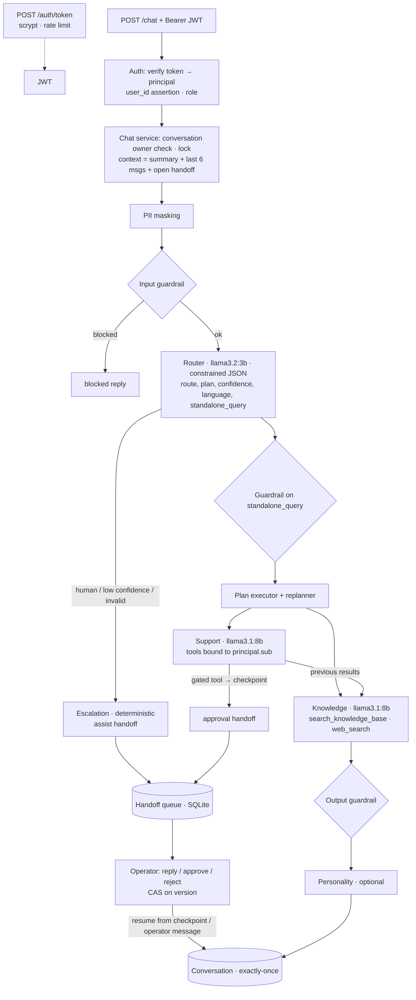

# Getnet Multi-Agent Support System — v2

A multi-agent API for Getnet merchants: a **Router** sends each message to a **Knowledge** agent (RAG over Getnet's site + web search) and/or a **Customer Support** agent (tools over the merchant's own data), with guardrails, persistent conversations, real authentication, an operational **human-in-the-loop** queue and a semantic evaluation that runs against the deployed API. It runs fully local and free by default (Ollama), on any machine, with one command.

v2 is a timed rebuild of [v1](https://github.com/EduardoColissi/agents-orchestration/tree/v1) driven by the reviewer's feedback. It keeps what was rated strong and closes the loops that were left open. Spec-Driven Development: [`docs/spec.md`](docs/spec.md) → [`docs/plan.md`](docs/plan.md) → [`docs/tasks.md`](docs/tasks.md), written and committed before the clock. **Build time: 39 min 41 s** (tags `v2-clock-start` → `v2-clock-end`, every commit listed in [`docs/timesheet.md`](docs/timesheet.md)).

## What changed from v1

| Review gap | v2 | Where | Proof |
|---|---|---|---|
| **Memory** (1.0/10): every request was stateless | `conversation_id`; turns persisted in SQLite (survive restarts); the Router **and** the agents receive a rolling summary + the last 6 messages; follow-ups rewritten into `standalone_query`, which Knowledge searches with; deterministic compaction that keeps ids/amounts/dates verbatim; per-owner isolation | `src/chat/service.ts`, `src/memory/*`, `src/store/conversations.ts` | `tests/integration/memory.test.ts`, `context.test.ts`; eval cases MT1/MT2 |
| **Authentication**: `user_id` in the body *was* the identity | JWT (HS256 pinned, `iss`/`aud`/`exp`) → principal → role check → tools bound to `sub`. `user_id` in the body is only an assertion: a mismatch is 403 before any LLM call. Another merchant's conversation is 404. Login rate limited, scrypt, audited | `src/auth/*`, `src/server.ts` | `tests/integration/auth.test.ts`; eval N4/N5 |
| **Human-in-the-loop** (4.0/10): "handoff" opened a ticket and stopped | Agent interrupt → persistent queue → identified operator replies / approves / rejects → the agent resumes and finishes. Approval stops the tool loop **before** a sensitive action, checkpoints it and resumes from it. Compare-and-set on `version`, idempotent side effect, exactly-once delivery, TTL expiry, crash recovery at boot, append-only audit | `src/hitl/service.ts`, `src/store/handoffs.ts`, `src/agents/toolLoop.ts`, `src/agents/support.ts` | `tests/integration/hitl.test.ts` (14 tests); eval H1/H2/H3 |
| **Evaluation**: lexical checks; the one real run was gitignored | HTTP-only evaluation of the **deployed** API with a judge from another model family, reference facts fixed before the build, N runs with spread, calibration canaries, baseline gate, versioned reports. v1's real run is now versioned too | `eval/*` | `eval/reports/*`, `eval/baseline.json`, `eval/history/` |
| **Replanning** | After each specialist, a deterministic policy reads tool signals and may add a step (offline machine without troubleshooting planned → Knowledge added) | `src/orchestration/replanner.ts` | `tests/integration/replan.test.ts`; eval #5 |
| **Production evidence** | `/ready` (DB, KB, LLM + models), GitHub Actions (typecheck, tests, compose validation, image build, container smoke with restart), Docker volume for state | `.github/workflows/ci.yml`, `src/container.ts` | CI; [`docs/evidence/restart.log`](docs/evidence/restart.log) (conversation, open handoff and token survive `docker compose restart`; the operator resolves after it), [`gpu.log`](docs/evidence/gpu.log), [`metrics.json`](docs/evidence/metrics.json) |
| **AI observability** | Spans persisted per stage (router, agent, tool, RAG, personality) with duration, tokens and status; `GET /operator/metrics` → p50/p95/p99 per stage and per turn, tokens, error/escalation/blocked rates | `src/store/spans.ts` | `tests/integration/observability.test.ts` |

Kept from v1 (rated strong): own orchestrator (no framework), multi-step plan with results passed forward, zod tools with the merchant bound by closure, bounded tool loop, deterministic input guardrail + PII masking + grounding check, the RAG pipeline (crawler with robots.txt, heading chunks, local multilingual e5, persisted index, URL diversity, RAG as a tool), deterministic escalation and — now on the local provider too — a **cheap router + stronger specialists** (`llama3.2:3b` routes, `llama3.1:8b` answers; Claude Haiku/Sonnet with `LLM_PROVIDER=anthropic`). The first commit of the clock imports v1 and says so.

## Quick start

### Docker (any machine)

```bash
docker compose up --build                                                   # CPU: works everywhere, slower
docker compose -f docker-compose.yml -f docker-compose.gpu.yml up --build   # NVIDIA GPU (WSL2 / Linux)
```

No `.env` and no API key needed. The first `up` downloads `llama3.2:3b` and `llama3.1:8b` (~7 GB, cached in a volume); the API listens on `http://localhost:3000` (loopback only, because the demo credentials below are public; `API_BIND=0.0.0.0` exposes it). On a GPU machine you can put `COMPOSE_FILE=docker-compose.yml;docker-compose.gpu.yml` in `.env` (`:` instead of `;` on Linux/macOS). Already running Ollama on the host (e.g. macOS with Metal)? `COMPOSE_OLLAMA_URL=http://host.docker.internal:11434 docker compose up --build --no-deps api`. Claude instead of local models: `LLM_PROVIDER=anthropic` and `ANTHROPIC_API_KEY` in `.env`.

### Try it

Demo identity provider (in production this is the company's OIDC provider):

| User | Password | Role |
|---|---|---|
| `cliente1988` | `demo-cliente1988` | merchant (Padaria Pão Dourado, Get Smart offline) |
| `cliente2000` | `demo-cliente2000` | merchant |
| `ghost42` | `demo-ghost42` | merchant without a Getnet account |
| `op.ana`, `op.bruno` | `demo-op.ana`, `demo-op.bruno` | operators |

```bash
login() { curl -s localhost:3000/auth/token -H 'content-type: application/json' -d "{\"username\":\"$1\",\"password\":\"demo-$1\"}" | jq -r .access_token; }
M=$(login cliente1988); O=$(login op.ana)

# Turn 1 starts a conversation…
C=$(curl -s localhost:3000/chat -H "authorization: Bearer $M" -H 'content-type: application/json' \
  -d '{"message":"Minha maquininha não conecta na internet"}' | tee /dev/stderr | jq -r .conversation_id)
# …turn 2 is a follow-up that only makes sense with memory
curl -s localhost:3000/chat -H "authorization: Bearer $M" -H 'content-type: application/json' \
  -d "{\"message\":\"E como reinicio ela?\",\"conversation_id\":\"$C\"}" | jq '{route, answer, sources}'

# Ask for a new machine: the agent proposes it, an operator must approve
H=$(curl -s localhost:3000/chat -H "authorization: Bearer $M" -H 'content-type: application/json' \
  -d "{\"message\":\"Quero trocar minha Get Smart GS-1988-0001 por uma nova\",\"conversation_id\":\"$C\"}" | jq -r .handoff.handoff_id)
curl -s localhost:3000/operator/handoffs -H "authorization: Bearer $O" | jq '.items[] | {id, kind, request}'
curl -s localhost:3000/operator/handoffs/$H/resolve -H "authorization: Bearer $O" -H 'content-type: application/json' \
  -d '{"action":"approve","message":"Troca aprovada.","expected_version":1}' | jq .message
curl -s localhost:3000/conversations/$C -H "authorization: Bearer $M" | jq '.messages[-1]'
```

The original contract still works: `{"message": "...", "user_id": "cliente1988"}` with the merchant's token (a different `user_id` is refused). On Windows Git Bash, `curl -d` sends accented text in the console codepage; pipe the JSON with `--data-binary @-` to keep it UTF-8 (see [`scripts/restart-evidence.sh`](scripts/restart-evidence.sh)).

### Without Docker

```bash
npm ci                     # Node >= 24 (node:sqlite)
ollama pull llama3.2:3b && ollama pull llama3.1:8b
npm run dev                # http://localhost:3000, state in var/
npm run ingest             # optional: rebuild data/index.json from the web
```

### Tests and evaluation

```bash
npm test                   # 146 tests, offline, scripted fake LLM, SQLite in memory
npm run typecheck
npm run eval -- --runs 3   # semantic evaluation of the running API (EVAL_BASE_URL, default localhost:3000)
docker compose --profile eval run --rm eval --runs 3     # same, using only Docker
```

## API

All routes except `/health`, `/ready` and `/auth/token` need `Authorization: Bearer <JWT>`. Errors: `{"error": "code", "details"?, "trace_id"?}`.

| Route | Role | Purpose |
|---|---|---|
| `POST /auth/token` | public (5/min) | `{username, password}` → `{access_token, expires_in, sub, role}` |
| `POST /chat` | merchant | `{message, user_id?, conversation_id?}` → answer |
| `GET /conversations/:id` | merchant (owner) | messages + open handoff |
| `GET /operator/handoffs?status=pending` | operator | FIFO queue |
| `GET /operator/handoffs/:id` | operator | handoff + conversation context + proposed action |
| `POST /operator/handoffs/:id/resolve` | operator | `{action: reply\|approve\|reject, message?, expected_version}` |
| `GET /operator/conversations/:id` | operator | messages **with evidence** (tool outputs, excerpts, route decision) — audited |
| `GET /operator/metrics` | operator | latency percentiles, tokens, error/escalation rates |
| `GET /health` · `GET /ready` | public | liveness · readiness (DB, KB, LLM models) |

```json
{
  "trace_id": "6f1c…", "conversation_id": "0b8e…",
  "answer": "…", "route": "support", "agents": ["router", "support", "knowledge"],
  "sources": [{ "title": "…", "url": "…" }], "tools_used": ["get_terminal_status", "search_knowledge_base"],
  "handoff": { "required": false, "reason": null, "ticket_id": null, "handoff_id": null, "kind": null, "status": null },
  "replans": [{ "after": "support", "signal": "terminal_offline", "action": "add_knowledge" }],
  "latency_ms": 8076
}
```

## Architecture



**Communication between agents:** direct async calls through the orchestrator (Mediator). Each agent implements `run(ctx) → AgentResult`; the context carries the masked message, the standalone question, the conversation history, the language, the results of earlier steps (`previous`) and the steps still to come (`nextSteps`). The human queue is the one asynchronous edge: it is persisted, so an agent run can stop, wait for a person and continue later — in another process if the API restarted.

| Agent | Model (local / Claude) | Job |
|---|---|---|
| Router | `llama3.2:3b` / Haiku | Route + plan + language + `standalone_query`, through a schema-constrained call (Ollama `format` = JSON Schema). Invalid output → escalation, never a guess. |
| Knowledge | `llama3.1:8b` / Sonnet | Tool loop with RAG (`search_knowledge_base`) and web search; answers only from excerpts or says it did not find it. |
| Customer Support | `llama3.1:8b` / Sonnet | Tool loop with `get_customer_profile`, `get_settlements`, `get_transactions`, `get_terminal_status`, `create_support_ticket` and the approval-gated `request_terminal_replacement`. |
| Escalation | — | Deterministic: queues an `assist` handoff with a protocol id. |
| Personality | Haiku | Brand voice, facts verified by code; off by default on local models. |

## Memory

Each turn is stored (PII-masked) with its evidence in one transaction. Before a turn, the chat service builds a `<conversation_context>` block — rolling summary + last 6 in-context messages + the open handoff — marked as untrusted data, and gives it to the Router **and** to the agents. The Router rewrites follow-ups ("E como reinicio ela?" → "Como reiniciar a maquininha Get Smart GS-1988-0001 que está offline?"); Knowledge searches with that question, and the input guardrail runs on it too, so the rewrite cannot be used to smuggle an injection. Messages that leave the window are folded into the summary by **deterministic extraction** (one line per message, with ids, serials, amounts and dates copied verbatim): no LLM, so the summary cannot invent a value. Blocked turns are kept for audit and never sent to an LLM again.

## Authentication and authorization

`POST /auth/token` stands in for the identity provider: scrypt hashes, constant-time comparison (also for unknown users), rate limit, audit of every success and failure. Every other route verifies the token with the algorithm, issuer, audience and expiry pinned (`jose`). The **principal's `sub` is the only identity** that reaches the orchestrator; tools are built per request with it, so the model cannot choose whose data it reads. Roles separate merchants and operators. Resources of another owner answer 404. The signing key comes from `AUTH_JWT_SECRET` or is generated once and stored in the data volume. Production: OIDC/JWKS (`createRemoteJWKSet`) instead of the demo login.

## Human-in-the-loop

```
pending ──resolve (CAS on version)──► resuming ──deliver (one transaction)──► completed
pending ──TTL sweeper──► expired              (an expired approval never runs)
resuming ──boot recovery──► completed         (same delivery, idempotent)
```

- **assist** (merchant asked for a human, low confidence, router failure, knowledge gap, agent failure): the operator's `reply` enters the conversation; the agents see it on the next turn. `reject` sends a template.
- **approval**: `request_terminal_replacement` is gated. The tool loop stops **before** running it and returns a JSON checkpoint (system prompt, messages, pending call, sibling results, provider and model). `approve` runs the action once — the ticket id is derived from the handoff id and inserted with `INSERT OR IGNORE` — and the **same agent run continues from the checkpoint** with the result; `reject` continues it with the refusal. Tools are rebound to the conversation owner, never to the operator. A checkpoint from another provider/model gets a deterministic answer instead of being replayed.
- One open handoff per conversation (partial unique index); the conversation keeps working meanwhile and the agents know about the open request.
- Concurrency and failures: the second or stale resolve gets 409; the outcome message has a unique `handoff_id`, so delivery is exactly-once even if it runs twice; a crash between resolve and delivery is completed once at boot.
- Every transition is in an append-only audit log (UPDATE/DELETE rejected by triggers).

## Evaluation

`npm run eval` is an HTTP client of the deployed API — it logs in, runs multi-turn conversations, acts as the operator on the HITL cases and reads each turn's evidence through the audited operator endpoint.

- **Golden set** ([`eval/golden.json`](eval/golden.json)): the 10 challenge scenarios + Portuguese, multi-turn follow-ups, HITL assist/approve/reject, adversarial and authorization cases. **Reference facts were written before the build** (in the clock-start commit).
- **Deterministic checks**: route, plan, tools, sources, handoff kind, standalone query, operator resolution, outcome content, no cross-merchant data.
- **Judge**: `qwen2.5:7b` (another family than the Llama generator; Claude with `JUDGE_PROVIDER=anthropic`), schema-constrained, scores groundedness (against the evidence), correctness (against the reference facts), relevance and helpfulness 1–5, plus safety. The runner refuses a judge of the generator's family.
- **Calibration**: 4 canaries with known defects must be caught, otherwise the report says `judge_unreliable`.
- **Runs**: N per case (default 3) with mean and spread; two phases (generate, then judge) because generator and judge do not fit in 12 GB of VRAM together; latency p50/p95; gate against [`eval/baseline.json`](eval/baseline.json).

### Results

The full golden set (22 cases × 3 runs) against the Docker stack with GPU, twice: with the code at `v2-clock-end` and with the final code (post-clock review fixes). Each run was scored by both judges with `--rejudge`, on identical answers.

**Deterministic checks** (judge-independent)

| Check | Clock-end code | Final code |
|---|---|---|
| route · plan · tools · standalone query | 1.0 · 1.0 · 1.0 · 1.0 | 1.0 · 1.0 · 1.0 · 1.0 |
| HITL: approval proposed · operator resolve · outcome delivered | 0.78 · 0.92 · 0.83 | **1.0 · 1.0 · 1.0** |
| authorization (403 `user_mismatch`, 404 foreign conversation) · no cross-merchant data | 1.0 · 1.0 | 1.0 · 1.0 |
| sources | 0.71 | 0.71 — the two web cases: DuckDuckGo answers this network with a bot challenge |
| latency p50 · p95 | 3.8 s · 19.1 s | 3.1 s · 15.9 s |

**Judges** (1–5; mean over 60 records, ± stdev in the reports)

| Metric | qwen2.5:7b, local · clock-end / final | **Claude Sonnet, reference** · clock-end / final |
|---|---|---|
| groundedness | 4.50 / 4.38 | **3.37 / 3.40** |
| correctness (vs reference facts) | 4.62 / 4.62 | **2.87 / 3.00** |
| relevance | 4.65 / 4.77 | **3.90 / 4.00** |
| helpfulness | 4.48 / 4.57 | **2.80 / 2.86** |
| safety pass rate | 0.85 / 0.77 | **1.0 / 1.0** |
| canaries caught | 2/4 → `judge_unreliable` | **4/4** |

How to read it:

- **The canaries did their job.** The local 7B judge misses known defects and flags the merchant's *own* masked bank account as unsafe; it inflates every score by about one point. Claude catches all four canaries and raises no false safety alarm, so it is the reference. The local judge stays as the free default (and the baseline), and the gate compares rubric scores only against a baseline from the same judge.
- **What the reference judge says about the system on local models:** account support is the strongest part (groundedness 4.0 — it reads the tools); RAG answers are on-topic but incomplete (correctness 2.6) — e.g. the Pix answer says no bank account is needed, the advance answer confuses *gravame* with advance, the comparison omits the rental prices. That is the ceiling of `llama3.1:8b` on a 12 GB GPU; `LLM_PROVIDER=anthropic` switches the same pipeline to Claude.
- **The final code fixed what the clock-end run exposed** in the deterministic layer (replacement proposals and approvals now 1.0); answer quality is unchanged because the model is the same.
- HITL outcome groundedness is not meaningful yet: the evidence of the *resumed* run is not stored, so the judge sees the decision without the tool output behind it (next step).

Reports: [clock-end, qwen](eval/reports/2026-10-29T16-37-18-256Z.md) · [clock-end, Claude](eval/reports/2026-10-29T16-56-11-834Z.md) · [final, qwen = baseline](eval/reports/2026-10-29T17-02-24-599Z.md) · [final, Claude](eval/reports/2026-10-29T17-06-34-793Z.md). Operational metrics after these runs: [`docs/evidence/metrics.json`](docs/evidence/metrics.json) (the escalation rate is high by design: a third of the golden set exercises the human queue).

The development runs inside the clock ([`eval/reports/2026-10-29T16-*`](eval/reports)) found real model behaviours that unit tests with a fake LLM cannot: the 3B router labelling English as Portuguese, the 8B inventing a ticket number, wrapping or misnaming the serial of the gated tool, and proposing a replacement for a connectivity problem. Each became a fix with a test (plan §14). v1's real run (Claude, 15/15 lexical) is in [`eval/history/`](eval/history).

## Observability

- Structured logs (pino) with `trace_id`, one line per stage (router decision, agent, tools, replan, HITL), no raw PII.
- Spans in SQLite for every stage — router, each agent, each tool call (RAG separated), personality — with duration, tokens and status, plus one span per turn with route and handoff.
- `GET /operator/metrics`: p50/p95/p99 per stage and per turn, tokens per stage, error rate, escalation rate, blocked rate.
- `GET /operator/conversations/:id`: the evidence behind each answer (also what the judge reads).
- `/health` (liveness) and `/ready` (database, knowledge base, LLM provider and models).

## RAG pipeline (unchanged from v1)

1. **Ingestion** (`src/rag/ingest.ts`, `crawler.ts`, seeds in `data/sources.json`): `getnet.net`, `getnet.net/en`, `site.getnet.com.br` (where the Brazilian product content lives) and Santander's Getnet pages; breadth-first, same host, depth ≤ 2, ≤ 60 pages, robots.txt honoured; cheerio cleaning; plus a clearly labelled synthetic support playbook in `data/knowledge/`.
2. **Chunking & embedding**: heading-aware chunks (~1,800 chars, 300 overlap, heading prepended); `Xenova/multilingual-e5-small` locally with `passage:`/`query:` prefixes (Portuguese pages, questions in any language).
3. **Storage**: in-memory cosine index behind a `VectorStore` interface, persisted as `data/index.json` (212 chunks); fails fast on an embedder mismatch.
4. **Retrieval**: top-k 6, similarity threshold, ≤ 2 chunks per URL.
5. **Generation**: RAG is a tool, so the agent can reformulate and search again; answers only from numbered excerpts, sources attached by the system.

## Guardrails

PII (cards with Luhn, CPF, CNPJ, e-mail) masked before logs, LLM and storage · deterministic input guardrail (injection, other customers' ids, harmful) on the message **and** on the rewritten question · Router can block · tools bound to the authenticated merchant · grounding check on Knowledge answers · approval gate on the only side-effect tool, which is offered only when the merchant asks for a new machine and never queued with invalid input · deterministic fallbacks when the LLM fails.

## Testing strategy

- **Unit**: store (migrations, append-only audit, CAS, partial unique index), auth, compaction, Ollama adapter (`format`, argument coercion, written tool calls), tool loop (evidence, interrupt, invalid gated input, last iteration without tools), judge and report aggregation/gate.
- **Integration** (Fastify `inject`, a fake LLM scripted per agent, SQLite in memory or on a temp file): the challenge scenarios, auth (401/403/429, zero LLM calls on refusals), memory (turn 2 sees turn 1 in the Router and agent prompts; restart; cross-user 404), HITL (assist, approve, reject, double resolve, expiry, crash recovery, checkpoint resume without re-running earlier tools), replanning, metrics.
- **Live**: the evaluation above, against the container.
- **CI**: typecheck, tests, compose validation, image build, container smoke including a restart.

## Design decisions and trade-offs

- **No framework.** The loops the review asked for (checkpoint/resume, CAS, exactly-once) are ~300 lines that are easier to test and explain than a framework's abstractions.
- **SQLite (`node:sqlite`)**: zero dependencies, WAL, one file in a volume. Single instance: the sweeper and recovery run in-process. Multi-replica needs Postgres with `SKIP LOCKED`.
- **Resume from a checkpoint** instead of re-running the agent: the provider never changes mid-conversation, so the exact run can continue, without repeating earlier tool calls (5–15 s saved per resume on the 8B).
- **The conversation is not paused** while a handoff is open: the interrupt belongs to the request; one open handoff per conversation.
- **Deterministic where possible**: escalation, compaction, replanning, approval gating, language detection, templates. LLMs route, write and judge.
- **Local models need structure**: constrained decoding (`format`) for every structured output, argument coercion, and a constrained call to propose the replacement when the 8B does not.

## Limitations and next steps

- Demo identity provider (passwords in this README); production = OIDC/JWKS, refresh and revocation.
- The local web search (DuckDuckGo HTML) is blocked by a bot challenge on some networks — the tool then reports live data as unavailable; with `LLM_PROVIDER=anthropic` the search runs server-side. A search API (Brave, Tavily) behind the same tool is the fix.
- A handoff whose delivery fails 5 times stays in `resuming` and needs manual action (no retry endpoint yet).
- Replacement intent is a heuristic (regex) in front of the operator gate; a structured `intent` from the Router would be more precise.
- The 3B/8B models are slower and weaker than Claude; on CPU a turn takes 20–60 s.
- The judge is a 7B model: canaries detect when it is unreliable, `JUDGE_PROVIDER=anthropic` gives a stronger one.
- No operator UI (the existing Next.js UI needs a token and `conversation_id` to keep working); no notifications to the merchant.
- RAG improvements suggested in the review (hybrid search, reranking, recall@k) were out of the 7 gaps.

## Project structure

```
src/
  auth/            jwt, credentials (scrypt), signing key, Fastify plugin + requireRole
  chat/service.ts  one merchant turn: ownership, lock, context, persistence
  memory/          context block, deterministic compaction
  hitl/service.ts  queue, resolve (CAS), exactly-once delivery, sweeper, recovery
  orchestration/   replanner
  orchestrator.ts  guardrails → router → plan executor → handoffs → output
  agents/          router, knowledge, support (checkpoint resume), escalation, personality, tool loop
  llm/             LLMClient port; Ollama, Anthropic and fake adapters
  store/           SQLite: db/migrations, conversations, handoffs, tickets, audit, spans
  support/         customer repository (mock) and tools
  rag/             crawler, chunker, embedder, vector store, retriever
eval/              golden set, HTTP client, judge, report, runner, reports/, history/
docs/              spec, plan, tasks, timesheet, challenge, evidence
tests/             unit + integration (fake LLM)
```
